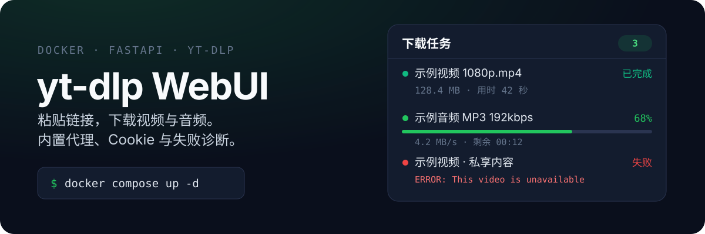

# yt-dlp WebUI

<p align="center">
  
</p>

一个自带 Web 界面的 [yt-dlp](https://github.com/yt-dlp/yt-dlp) 下载服务，前端用 **HeroUI（React）** 构建。
浏览器里粘贴链接就能下载视频或音频，支持并发任务、实时进度、**登录 Cookie**、**代理配置**和文件管理。

针对国内网络做了三件事：**代理一键测试**、**YouTube JS 挑战内置求解**、**失败日志自动脱敏落盘**。

## 文档

| 文档 | 内容 |
|---|---|
| [快速开始与使用](docs/quickstart.md) | 功能清单、Docker / Compose / 源码构建、输出格式、工作原理 |
| [代理与 Cookie](docs/network.md) | 国内网络代理配置、地址填法、排错对照、Cookie 导入 |
| [下载失败排查](docs/troubleshooting.md) | 失败日志位置、`docker logs`、JavaScript 运行时问题 |
| [部署与运维](docs/operations.md) | GitHub Actions、日志落盘、本地开发、环境变量 |
| [API](docs/api.md) | 全部 HTTP 接口与任务清理/任务库说明 |
| [项目结构](docs/project-structure.md) | 目录树、模块职责、测试清单 |

## 快速开始

不用克隆仓库，一条命令拉起容器（镜像由 GitHub Actions 每周构建）：

```bash
docker run -d --name yt-dlp-webui \
  -p 8080:8080 \
  -v "$PWD/downloads:/downloads" \
  -v "$PWD/config:/config" \
  --add-host=host.docker.internal:host-gateway \
  --restart unless-stopped \
  ghcr.io/dremous/yt-dlp-webui:latest
```

打开 **http://localhost:8080**，粘贴链接即可下载。

需要持久化目录说明、Docker Compose、从源码构建或输出格式对照表，见
[快速开始与使用](docs/quickstart.md)。

## 亮点

- **多档输出格式**：默认「最佳格式」不转码；MP4 支持 4K 到 480p 与 H.264 兼容档；音频支持 MP3 三档码率与原始音频
- **并发与续传**：最多 5 个任务并发；网络中断自动重试续传，失败后重新提交同一链接会接管上次的 `.part`
- **任务持久化**：记录写入 SQLite，容器重启后仍在；任务库损坏自动隔离，路径不可写时降级为不持久化
- **国内网络友好**：代理一键测试、`socks5h` 处理、内置 deno + `yt-dlp-ejs` 解 YouTube JS 挑战
- **失败可诊断**：失败日志脱敏落盘，最后 30 行同步到 `docker logs`，界面显示关键错误行

## 安全提示

- 请遵守目标网站的条款与版权规定，仅下载你有权下载的内容。
- 使用 Cookie 时注意保密：`./config` 目录含登录凭证与代理地址（可能带账号密码），
  不要提交到公开仓库（已加入 `.gitignore`）。
- 代理只影响 yt-dlp 的出站请求，不影响浏览器访问 WebUI 本身。
