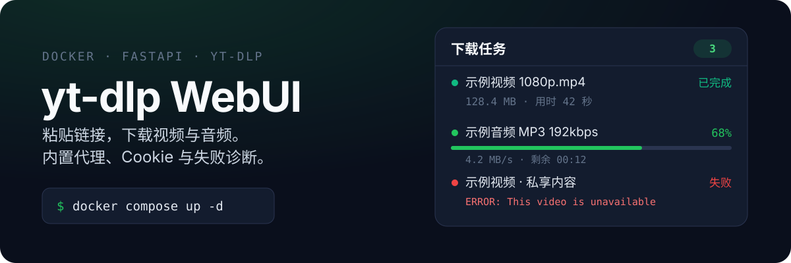
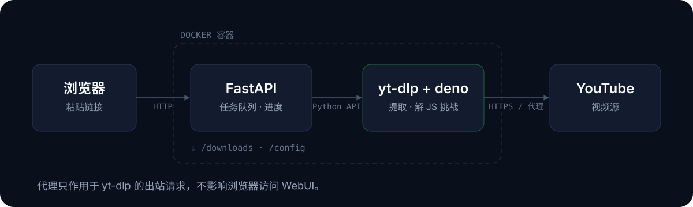

# yt-dlp WebUI

<p align="center">
  
</p>

一个自带 Web 界面的 [yt-dlp](https://github.com/yt-dlp/yt-dlp) 下载服务，前端用 **HeroUI（React）** 构建。
浏览器里粘贴链接就能下载视频或音频，支持并发任务、实时进度、**登录 Cookie**、**代理配置**和文件管理。

针对国内网络做了三件事：**代理一键测试**、**YouTube JS 挑战内置求解**、**失败日志自动脱敏落盘**。

**[快速开始](#快速开始)** · **[配代理](#国内网络配置代理)** · **[坏了怎么查](#下载失败怎么排查)** · **[API](#api)**

## 特性

### 下载

- **三种输出格式**：MP4 视频、最佳画质（原始格式）、MP3 音频（192kbps）
- **实时进度**：百分比、速度、剩余时间，每 1.5 秒刷新
- **并发任务**：最多 5 个同时下载，互不阻塞
- **登录 Cookie**：上传 `cookies.txt`，用于私享 / 会员 / 年龄受限内容
- **文件与任务管理**：网页内下载、删除文件；已结束任务可单独删除或一键清理，任务记录最多保留 50 条

### 国内网络

- **代理配置**：界面里填 HTTP / SOCKS5 地址，一键测试能否连通 YouTube
- **JS 挑战可解**：镜像内置 `deno` 与 `yt-dlp-ejs`，YouTube 的 `n` 参数签名能正常解开
- **失败可诊断**：失败时保留完整 yt-dlp 日志（代理密码自动脱敏），界面直接显示关键错误行

### 自托管

- **单容器**：多阶段构建（node → deno → python），内置 ffmpeg
- **多架构**：同时构建 `linux/amd64` 与 `linux/arm64`，服务器和 ARM NAS 通用
- **安全设计**：URL 全部走 yt-dlp Python API（无 shell 拼接），文件名做了路径穿越防护与 HTML 转义
- **自动更新**：每次构建拉取 yt-dlp nightly，配合定时重建始终跟随最新开发版

## 快速开始

不用克隆仓库，一条命令拉起容器（镜像由 GitHub Actions 每周构建）：

```bash
docker run -d --name yt-dlp-webui \
  -p 8080:8080 \
  -v "$PWD/downloads:/downloads" \
  -v "$PWD/config:/config" \
  --add-host=host.docker.internal:host-gateway \
  --restart unless-stopped \
  ghcr.io/dremous/yt-dlp-webui:latest
```

打开 **http://localhost:8080**，粘贴链接即可下载。

| 需要持久化的东西 | 挂载到 | 说明 |
|---|---|---|
| 视频、音频、失败日志 | `./downloads` | 丢掉容器不会丢成品 |
| Cookie 与代理地址 | `./config` | 含登录凭证，注意保密 |

> `--add-host=host.docker.internal:host-gateway` 让容器能访问宿主机上的代理。
> Linux / NAS 原生 Docker 必须加，Docker Desktop 自带可省略。

### 用 Docker Compose

```bash
git clone https://github.com/dremous/yt-dlp-webui.git
cd yt-dlp-webui
docker compose up -d
```

`docker-compose.yml` 已经写好卷映射、环境变量和 `extra_hosts`，适合长期部署。

### 从源码构建镜像

```bash
git clone https://github.com/dremous/yt-dlp-webui.git
cd yt-dlp-webui
docker build -t yt-dlp-webui .
# 再执行上面的 docker run，把最后的镜像名换成 yt-dlp-webui
```

构建会现场编译前端、拉取最新 yt-dlp nightly 与 deno 二进制，耗时几分钟。

## 工作原理

<p align="center">
  
</p>

浏览器只跟 FastAPI 打交道，真正的抓取发生在容器内的 yt-dlp，所以**代理只需要让 yt-dlp 能出网**，
浏览器访问 WebUI 本身不受代理影响。

| 层 | 选型 |
|---|---|
| 前端 | React 18 + HeroUI + Tailwind CSS + Vite |
| 后端 | Python 3.13 + FastAPI + Uvicorn |
| 下载引擎 | yt-dlp（nightly，Python API）+ deno（EJS 挑战求解） |
| 容器 | 多阶段镜像（node 构建前端 → deno 运行时 → python 运行），内置 ffmpeg |
| CI | GitHub Actions 定时构建，推送 GHCR（amd64 + arm64） |

## 国内网络：配置代理

大陆网络无法直连 YouTube（以及 Google 系域名），不带代理时任务会以
`Unable to download webpage` / 连接超时之类的错误失败。在 WebUI 的
**「网络代理」** 卡片里填好地址并点 **「测试连通」**，确认能通即可。

### 前提：让代理允许局域网连接

容器与宿主机网络是隔离的，代理必须监听非 loopback 地址，否则容器连不上：

- Clash / Clash Verge / Mihomo：打开 **「允许局域网连接」**（配置文件里的 `allow-lan: true`）
- v2ray / sing-box：监听地址设为 `0.0.0.0`
- 同时放行服务器防火墙上的代理端口（`7890` / `7891` 等）

> Linux / NAS 上这一步不做，页面上会一直提示「连接超时」。这是最常见的失败原因。

### 代理地址怎么填

| 代理所在位置 | 填法 |
|---|---|
| 就在同一台机器（宿主机）上 | `http://host.docker.internal:7890` |
| 是另一个 Docker 容器 | `http://<容器名>:7890`（需与本项目在同一 docker 网络） |
| 在局域网其他机器 / 软路由上 | `http://192.168.1.2:7890` |

- **不要填 `127.0.0.1`**——容器里的它指向容器自己，不是宿主机。填错时页面会直接给出提示。
- 只填 `主机:端口` 也可以，缺省按 `http://` 处理。
- 支持 `http` / `https` / `socks5` / `socks5h`；`socks5h` 由代理端解析域名，容器场景更省事。

### 排错对照

| 测试结果 | 通常原因 |
|---|---|
| 连接被拒绝 | 地址/端口写错，或代理没在监听该端口 |
| 连接超时 | 代理未开启「允许局域网连接」，或防火墙拦了端口 |
| SOCKS 代理不可用 | `socks5` 需要 PySocks，官方镜像已内置；自建环境请 `pip install PySocks` |
| 连通正常但下载仍失败 | 目标站点本身需要登录凭证，见下一节的 Cookie |

## 登录 Cookie

下载需要登录的站点（如 YouTube 会员 / 私享视频）时，先在浏览器安装 Cookie 导出插件
（如 "Get cookies.txt LOCALLY"），导出目标站点的 `cookies.txt`，然后在 WebUI 的
**「登录 Cookie」** 卡片中上传。之后所有下载请求都会自动携带这些 Cookie。
可随时上传覆盖或清除。

支持格式：Netscape `cookies.txt` 或 JSON（yt-dlp 的 `cookiefile` 选项）。

## 下载失败怎么排查

失败的任务会在下载目录里留下完整日志，其中代理地址的账号密码已自动脱敏：

```
downloads/<任务ID>/yt-dlp.log
```

同时，失败时最后 30 行日志会打印到容器日志，可以直接查看：

```bash
docker logs --tail 100 yt-dlp-webui
```

界面上的错误行取自日志里最后一条 `ERROR:`，末尾附上日志的相对路径。

> 日志只在失败时落盘，下载成功不会产生 `.log` 文件，`/api/files` 也不会把它列为下载成品。
> 内存中最多保留 2000 行、单行截断到 2000 字符，避免超长签名 URL 撑爆内存。

### 关于 JavaScript 运行时

YouTube 的播放地址带 JS 挑战（`n` 参数签名），yt-dlp 需要外部 JS 运行时才能解开。
镜像已内置 **deno** 与配套的 **yt-dlp-ejs** 脚本包，无需额外配置。

若日志里出现 `JS runtimes: none` 或 `[jsc] JS Challenge Providers: ... (unavailable)`，
说明镜像构建不完整（缺少上面两者），YouTube 提取会退化为「部分格式缺失」。

## 部署与运维

### 自动构建（GitHub Actions）

工作流位于 `.github/workflows/build-image.yml`，三种触发方式：

| 触发 | 时机 |
|---|---|
| `schedule` | 每周日 00:00 UTC（北京时间周日 08:00） |
| `workflow_dispatch` | 在 Actions 页面手动点击 "Run workflow" |
| `push` | 推送 `main` 分支或打 `v*` 标签 |

构建时从 GitHub `yt-dlp-nightly-builds` 源码安装 `yt-dlp`（模块名仍为 `yt_dlp`，代码零改动），
因此每次构建的镜像都内置最新 nightly。产物推送到 **GHCR**，标签为 `latest`、`DATE` 与 `DATE-SHORT_SHA`。

> 前置设置：GitHub 仓库 `Settings → Packages` 中启用 GHCR；首次使用时需为镜像设置可见性。
> 无需额外密钥——workflow 使用内置的 `GITHUB_TOKEN` 自动完成 GHCR 登录。
> 可选配置 `secrets.WEBHOOK_URL`（飞书 / 企业微信 / 钉钉机器人），构建失败时推送告警。

### 本地开发

```bash
# 1) 后端（Windows 下 /downloads、/config 等默认路径不可用，需显式覆盖）
pip install -r requirements.txt          # 需系统装有 ffmpeg
pip install -U yt-dlp                     # yt-dlp 不在 requirements.txt（镜像内由 Dockerfile 装 nightly）
DOWNLOAD_DIR=/tmp/ytdl-downloads \
COOKIE_FILE=/tmp/ytdl-config/cookies.txt \
PROXY_FILE=/tmp/ytdl-config/proxy.txt \
uvicorn app.main:app --reload --port 8080

# 2) 前端（另开终端，构建产物输出到 app/static）
cd web && npm install && npm run dev      # 开发服务器 http://localhost:5173，代理到 8080

# 3) 单元测试（只用标准库，不需要安装 yt-dlp）
python -m unittest discover -s tests -v
```

改了前端要 `cd web && npm run build` 才会在 `:8080` 生效。

### 配置项

| 环境变量 | 默认值 | 说明 |
|---|---|---|
| `DOWNLOAD_DIR` | `/downloads` | 下载文件存放目录 |
| `COOKIE_FILE` | `/config/cookies.txt` | Cookie 文件路径 |
| `PROXY_FILE` | `/config/proxy.txt` | 代理地址文件路径（一行 URL，由界面写入） |

对外端口通过 `-p 8080:8080` 映射，容器内固定监听 8080。

## API

| 方法 | 路径 | 说明 |
|---|---|---|
| GET | `/` | Web 界面 |
| GET | `/api/formats` | 可用输出格式 |
| POST | `/api/download` | 提交下载任务，body: `{"url": "...", "format": "mp4"}` |
| GET | `/api/tasks?limit=N` | 任务列表（含进度与全量已结束计数 `ended`；limit 默认 30，上限 50） |
| POST | `/api/tasks/{task_id}/cancel` | 取消排队/下载中的任务（失败/已取消任务不可取消） |
| DELETE | `/api/tasks/{task_id}` | 删除一个已结束的任务记录（失败/取消的任务连带清理任务目录，已完成的保留文件） |
| POST | `/api/tasks/cleanup` | 清理全部已结束的任务记录，返回实际删除数量 |
| GET | `/api/files` | 已下载文件列表 |
| GET | `/files/{filename:path}` | 下载指定文件（相对路径，含任务子目录） |
| DELETE | `/api/files/{filename:path}` | 删除指定文件 |
| POST | `/api/cookies` | 上传 Cookie 文件（multipart，字段 `file`） |
| GET | `/api/cookies/status` | 查询 Cookie 状态 |
| DELETE | `/api/cookies` | 清除 Cookie |
| GET | `/api/proxy` | 查询代理状态 |
| PUT | `/api/proxy` | 保存代理，body: `{"url": "http://host.docker.internal:7890"}` |
| DELETE | `/api/proxy` | 清除代理，恢复直连 |
| POST | `/api/proxy/test` | 测试代理能否连通 YouTube（body 可传 `{"url": "..."}` 测未保存的地址） |
| GET | `/api/about` | 应用信息（版本 / yt-dlp 版本 / 作者） |

> 清理接口用 `POST` 而不是 `DELETE /api/tasks`，是为了避免被误读成「删除全部任务」，包括正在下载的那些。
> 任务记录最多保留 50 条，超出时自动裁剪最旧的记录，但**不会删除磁盘文件**——回收残留要靠上面两个接口。

## 项目结构

```
.
├── Dockerfile                    # 多阶段构建（node 前端 → deno 运行时 → python 后端）
├── docker-compose.yml            # Compose 编排（downloads + config 卷）
├── requirements.txt              # Python 依赖（yt-dlp 由 Dockerfile 装 nightly）
├── assets/readme/                # README 配图（纯 SVG，可手改）
├── .github/workflows/
│   └── build-image.yml           # 定时构建并推送 GHCR
├── web/                          # 前端源码（React + HeroUI + Vite）
│   ├── index.html
│   ├── package.json
│   ├── vite.config.js
│   ├── tailwind.config.js
│   └── src/
│       ├── main.jsx
│       ├── App.jsx
│       ├── api.js
│       └── components/
│           ├── DownloadForm.jsx
│           ├── CookiePanel.jsx
│           ├── ProxyPanel.jsx
│           ├── TaskList.jsx
│           └── FileList.jsx
├── app/
│   ├── main.py                   # FastAPI 入口 + 全部路由
│   ├── downloader.py             # 任务调度、并发、进度、代理、Cookie
│   ├── tasklog.py                # 日志收集、凭证脱敏与失败摘要
│   └── static/                   # 前端构建产物（vite 自动输出，勿手改）
└── tests/
    ├── test_tasklog.py           # 日志脱敏与摘要
    └── test_task_lifecycle.py    # 任务删除与目录清理策略
```

## 说明

- 请遵守目标网站的条款与版权规定，仅下载你有权下载的内容。
- 使用 Cookie 时注意保密：`./config` 目录含登录凭证与代理地址（可能带账号密码），
  不要提交到公开仓库（已加入 `.gitignore`）。
- 代理只影响 yt-dlp 的出站请求，不影响浏览器访问 WebUI 本身。
