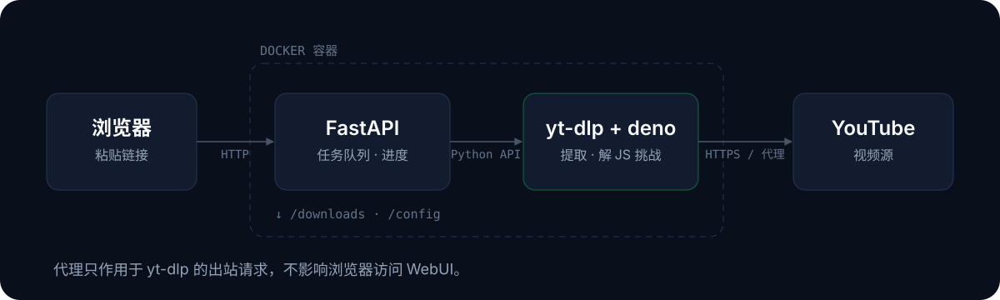

# 快速开始与使用

[返回 README](../README.md)

## 特性

### 下载

- **多档输出格式**：默认「最佳格式」（不转码，直接拿站点最高画质）；MP4 另有 4K 到 480p 逐档可选
  与 H.264 兼容版；音频支持 MP3 三档码率，以及不转码的原始音频
- **实时进度**：百分比、速度、剩余时间，每 1.5 秒刷新；音视频分离的站点按两条流的合计进度推进，
  不会在下完视频轨后掉回 0 再走一遍；合并 / 转码阶段单独标出，不再显示成「下载中」
- **并发任务**：最多 5 个同时下载，互不阻塞
- **断点续传**：网络中断自动重试并续传（默认 20 次，指数退避）；大文件按块下载，单次断流最多回退到本块起点
  （块内断流还能靠 `.part` 从偏移继续，通常不必重下整块）；失败后重新提交同一链接，
  会把上次没下完的 `.part` 接管过来接着下，不必从 0 再来一遍
- **任务持久化**：任务记录写入 SQLite，容器重启后仍在；重启时没跑完的任务标为失败、进度清零并写明原因，
  点「重试」即可把 `.part` 接管过来继续下；任务库损坏会自动备份重建，路径不可写时降级为本次运行不持久化，
  不会阻塞启动
- **登录 Cookie**：上传 `cookies.txt`，用于私享 / 会员 / 年龄受限内容
- **文件与任务管理**：网页内下载、删除文件；已结束任务可单独删除或一键清理，任务记录最多保留 50 条

| 输出格式 | 产物 |
|---|---|
| 最佳格式（默认） | 不改编码与容器，直接取站点最高画质，可能是 webm / AV1 |
| MP4 视频（最高 mp4 画质） | 不限分辨率，mp4 视频 + m4a 音频合并 |
| MP4 4K / 2K / 1080p / 720p / 480p | 按分辨率上限选流，源更高时自动降档 |
| MP4 H.264 | 优先 `avc1`，老设备与剪辑软件只认它 |
| MP3 320 / 192 / 128 kbps | 只下音轨后转码 |
| 原始音频（不转码） | 直接抽出 AAC / Opus，最快最无损 |

### 国内网络

- **代理配置**：界面里填 HTTP / SOCKS5 地址，一键测试能否连通 YouTube；`socks5://` 自动按 `socks5h://` 处理（域名交给代理端解析）
- **JS 挑战可解**：镜像内置 `deno` 与 `yt-dlp-ejs`，YouTube 的 `n` 参数签名能正常解开
- **失败可诊断**：失败时保留完整 yt-dlp 日志（代理密码自动脱敏），界面直接显示关键错误行

### 自托管

- **单容器**：多阶段构建（node → deno → python），内置 ffmpeg
- **多架构**：同时构建 `linux/amd64` 与 `linux/arm64`，服务器和 ARM NAS 通用
- **安全设计**：URL 全部走 yt-dlp Python API（无 shell 拼接），文件名做了路径穿越防护与 HTML 转义
- **自动更新**：每次构建拉取 yt-dlp nightly，配合定时重建始终跟随最新开发版
- **日志可落盘**：运行日志默认写到 `/config/webui.log` 并按 10MB × 5 份轮转，`LOG_FILE` / `LOG_LEVEL` / `LOG_CONSOLE` 可调

## 快速开始

不用克隆仓库，一条命令拉起容器（镜像由 GitHub Actions 每周构建）：

```bash
docker run -d --name yt-dlp-webui \
  -p 8080:8080 \
  -v "$PWD/downloads:/downloads" \
  -v "$PWD/config:/config" \
  --add-host=host.docker.internal:host-gateway \
  --restart unless-stopped \
  ghcr.io/dremous/yt-dlp-webui:latest
```

打开 [http://localhost:8080](http://localhost:8080)，粘贴链接即可下载。

容器默认时区为 `Asia/Shanghai`；需要其他时区时加 `-e TZ=Asia/Tokyo`（使用 IANA 时区名）。

| 需要持久化的东西 | 挂载到 | 说明 |
|---|---|---|
| 视频、音频、失败日志 | `./downloads` | 丢掉容器不会丢成品 |
| Cookie 与代理地址 | `./config` | 含登录凭证，注意保密 |

> `--add-host=host.docker.internal:host-gateway` 让容器能访问宿主机上的代理。
> Linux / NAS 原生 Docker 必须加，Docker Desktop 自带可省略。

### 用 Docker Compose

```bash
git clone https://github.com/dremous/yt-dlp-webui.git
cd yt-dlp-webui
docker compose up -d
```

`docker-compose.yml` 已经写好卷映射、环境变量和 `extra_hosts`，适合长期部署。

下载文件默认归属容器内 UID/GID `10001`。要让文件直接归宿主机用户，在项目根目录的
`.env` 里写 `PUID=1000`、`PGID=1000`（改成 `id -u` / `id -g` 的实际值），再
`docker compose up -d`；入口脚本会修正 `./downloads` 和 `./config` 的归属后降权运行。
同一个 `.env` 里还可以用 `TZ=Asia/Shanghai`（默认）或 `TZ=UTC` 等 IANA 时区名调整容器时间。

### 从源码构建镜像

```bash
git clone https://github.com/dremous/yt-dlp-webui.git
cd yt-dlp-webui
docker build -t yt-dlp-webui .
# 再执行上面的 docker run，把最后的镜像名换成 yt-dlp-webui
```

构建会现场编译前端、拉取最新 yt-dlp nightly 与 deno 二进制，耗时几分钟。

## 工作原理

<p align="center">
  
</p>

浏览器只跟 FastAPI 打交道，真正的抓取发生在容器内的 yt-dlp，所以**代理只需要让 yt-dlp 能出网**，
浏览器访问 WebUI 本身不受代理影响。

| 层 | 选型 |
|---|---|
| 前端 | React 18 + HeroUI + Tailwind CSS + Vite |
| 后端 | Python 3.13 + FastAPI + Uvicorn |
| 下载引擎 | yt-dlp（nightly，Python API）+ deno（EJS 挑战求解） |
| 容器 | 多阶段镜像（node 构建前端 → deno 运行时 → python 运行），内置 ffmpeg |
| CI | GitHub Actions 定时构建，推送 GHCR（amd64 + arm64） |
